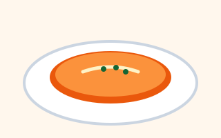
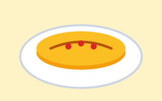
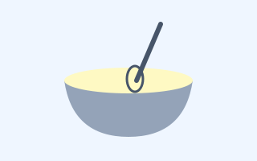

# Hintergründe: Die Komponenten der Rezeptverwaltung

## Gesamtstruktur

```text
<body>
├── <header>            Komponente 1: Kopf der ganzen Seite
├── <aside>             Komponente 2: Seitennavigation (links)
├── <main>              Komponente 3: Hauptinhalt (Mitte)
├── <aside>             Komponente 4: Zusatzinfos (rechts)
└── <footer>            Komponente 5: Fuß der ganzen Seite
```

* Es gibt genau **einen** `<header>`, **einen** `<main>` und **einen** `<footer>`. Sie stehen direkt im `<body>`, weil sie die **ganze Seite** betreffen. So ist eindeutig, wo der Hauptinhalt steht – für Suchmaschinen und Screenreader.
* Alle fünf Komponenten sind **Block-Elemente**. Deshalb stehen sie im Browser **untereinander**. Das 3-Spalten-Design (Seitennavigation | Main | Zusatzinfos) entsteht erst später mit **CSS**, das HTML bleibt dabei gleich.

## Komponente 1: Header

### Code

```html
<header id="top">
    <h1>
        Kochbuch der 2BHIF
    </h1>
    <nav id="haupt-nav">
        <ul>
            <li>
                <a href="index.html">Startseite</a>
            </li>
            <li>
                <a href="rezepte.html">Alle Rezepte</a>
            </li>
            <li>
                <a href="einreichen.html">Rezept einreichen</a>
            </li>
        </ul>
    </nav>
    <form action="https://httpbin.org/post" method="POST">
        <p>
            <label for="benutzername">Benutzername:</label>
            <input id="benutzername" type="text" name="benutzername" required>
        </p>
        <p>
            <label for="passwort">Passwort:</label>
            <input id="passwort" type="password" name="passwort" required>
        </p>
        <p>
            <input id="angemeldet-bleiben" type="checkbox" name="angemeldet_bleiben" value="ja">
            <label for="angemeldet-bleiben">Angemeldet bleiben</label>
        </p>
        <p>
            <button type="submit">Anmelden</button>
        </p>
    </form>
</header>
```

### Schachtelung

* Der `<header>` ist der **Kopf der ganzen Seite**. Darin stehen der Name der Website (`<h1>`), die Hauptnavigation und das Login – alles, was auf **jeder** Seite gleich ist.
* Die **Hauptnavigation** ist eine Liste von Links: `<nav>` → `<ul>` → `<li>` → `<a>`. In `<ul>` dürfen direkt **nur** `<li>` stehen; der Link `<a>` ist inline und liegt im `<li>`.
* Das **Login** ist ein `<form>` mit `method="POST"`: Benutzername und Passwort sollen **nicht** in der URL stehen, sondern im **Body** des Requests.
* `<label for="passwort">` gehört zum `<input id="passwort">` (gleicher Wert bei `for` und `id`). Das `name`-Attribut ist der **Schlüssel für den Server** – ohne `name` würde der Wert nicht mitgeschickt.
* Label und Eingabefeld sind inline. Deshalb packe ich jedes Paar in einen `<p>`, damit es eine eigene Zeile bekommt.
* `id="top"` am `<header>` ist das Sprungziel für den Link „Nach oben“ im Footer.

### Verwendete Tags

| Tag | Block oder Inline | liegt in | Bedeutung |
| :--- | :--- | :--- | :--- |
| `<header>` | Block | `<body>` | Kopf der ganzen Seite |
| `<h1>` | Block | `<header>` | wichtigste Überschrift, genau einmal pro Seite |
| `<nav>` | Block | `<header>` | Navigationsblock (Hauptnavigation) |
| `<ul>` | Block | `<nav>` | ungeordnete Liste der Links |
| `<li>` | Block | `<ul>` | ein Listenpunkt |
| `<a>` | Inline | `<li>` | Link zu einer anderen Seite (Navigation) |
| `<form>` | Block | `<header>` | Formular, schickt Daten per POST an den Server |
| `<p>` | Block | `<form>` | gruppiert je ein Label und ein Eingabefeld |
| `<label>` | Inline | `<p>` | Beschriftung, über `for` mit dem Feld verbunden |
| `<input>` | Inline (Non-Closing) | `<p>` | Eingabefeld: `text`, `password`, `checkbox` |
| `<button>` | Inline | `<p>` | `type="submit"` schickt das Formular ab |

## Komponente 2: Seitennavigation

### Code

```html
<aside id="seiten-nav">
    <h2>
        Auf dieser Seite
    </h2>
    <nav>
        <ul>
            <li>
                <a href="#suche">Rezeptsuche</a>
            </li>
            <li>
                <a href="#kategorien">Kategorien</a>
            </li>
            <li>
                <a href="#neue-rezepte">Neue Rezepte</a>
            </li>
            <li>
                <a href="#rezept-der-woche">Rezept der Woche</a>
            </li>
        </ul>
    </nav>
</aside>
```

### Schachtelung

* Die Seitennavigation **begleitet** den Hauptinhalt, ist aber nicht selbst Hauptinhalt – deshalb ein `<aside>`.
* Darin steht ein eigenes `<nav>`: Eine Seite darf **mehrere** `<nav>` haben (Haupt- und Seitennavigation).
* Die Links sind ein **Inhaltsverzeichnis**: `href="#suche"` springt zum Element mit `id="suche"` auf **derselben Seite** (Anker).

### Verwendete Tags

| Tag | Block oder Inline | liegt in | Bedeutung |
| :--- | :--- | :--- | :--- |
| `<aside>` | Block | `<body>` | begleitende Spalte neben dem Hauptinhalt |
| `<h2>` | Block | `<aside>` | Überschrift der Spalte |
| `<nav>` | Block | `<aside>` | Navigationsblock (Seitennavigation) |
| `<ul>` | Block | `<nav>` | Liste der Sprungmarken |
| `<li>` | Block | `<ul>` | ein Eintrag im Inhaltsverzeichnis |
| `<a href="#…">` | Inline | `<li>` | Anker-Link zu einer `id` auf dieser Seite |

## Komponente 3: Main

### Code

```html
<main>
    <section id="suche">
        <h2>
            Rezeptsuche
        </h2>
        <form action="https://httpbin.org/get" method="GET">
            <p>
                <label for="suchbegriff">Suchbegriff:</label>
                <input id="suchbegriff" type="search" name="q" placeholder="z. B. Palatschinken">
            </p>
            <p>
                <label for="kategorie">Kategorie:</label>
                <select id="kategorie" name="kategorie">
                    <option value="alle">Alle Kategorien</option>
                    <option value="hauptspeise">Hauptspeise</option>
                    <option value="dessert">Dessert</option>
                    <option value="suppe">Suppe</option>
                </select>
            </p>
            <p>
                <button type="submit">Suchen</button>
            </p>
        </form>
    </section>

    <section id="kategorien">
        <h2>
            Kategorien
        </h2>
        <p>
            Stöbere in unseren Rezepten nach <strong>Kategorie</strong>.
        </p>
        <figure>
            
            <figcaption>
                <a href="kategorien/suppen.html">Suppen</a>
            </figcaption>
        </figure>
        <!-- zwei weitere <figure>: Hauptspeisen, Desserts -->
    </section>

    <section id="neue-rezepte">
        <h2>
            Neue Rezepte
        </h2>
        <article>
            <h3>
                Kürbiscremesuppe
            </h3>
            <figure>
                
                <figcaption>
                    Kürbiscremesuppe mit Kürbiskernen
                </figcaption>
            </figure>
            <p>
                Eine <strong>cremige</strong> Suppe für kalte Herbsttage – fertig in <em>30 Minuten</em>.
            </p>
            <p>
                Veröffentlicht am <time datetime="2026-11-10">10. November 2026</time>
            </p>
            <p>
                <a href="rezepte/kuerbiscremesuppe.html">Zum Rezept</a>
                <button type="button">Merken</button>
            </p>
        </article>
        <!-- drei weitere <article> mit gleichem Aufbau: Kaiserschmarrn, Wiener Schnitzel, Apfelstrudel -->
    </section>

    <article id="rezept-der-woche">
        <h2>
            Rezept der Woche: Palatschinken
        </h2>
        <p>
            Von <strong>Lena</strong> aus der 2BHIF, <time datetime="2026-11-17">17. November 2026</time>
        </p>
        <p>
            Palatschinken sind dünne Pfannkuchen und schnell gemacht.
            Zuerst findest du die Zutaten für vier Personen, danach die Zubereitung Schritt für Schritt – zu jedem Schritt gibt es ein Bild.
        </p>
        <figure>
            
            <figcaption>
                Abb. 1: Palatschinken mit Marillenmarmelade
            </figcaption>
        </figure>
        <section>
            <h3>
                Zutaten
            </h3>
            <table>
                <tr>
                    <th>
                        Zutat
                    </th>
                    <th>
                        Menge
                    </th>
                </tr>
                <tr>
                    <td>
                        Mehl
                    </td>
                    <td>
                        200 g
                    </td>
                </tr>
                <!-- weitere Zeilen: Milch, Eier -->
            </table>
        </section>
        <section>
            <h3>
                Zubereitung
            </h3>
            <ol>
                <li>
                    <p>
                        Mehl, Milch, Eier und Salz zu einem <em>glatten</em> Teig verrühren.
                    </p>
                    <figure>
                        
                        <figcaption>
                            Abb. 2: Teig verrühren
                        </figcaption>
                    </figure>
                </li>
                <!-- weitere Schritte mit gleichem Aufbau -->
            </ol>
        </section>
        <details>
            <summary>
                Nährwerte anzeigen
            </summary>
            <ul>
                <li>
                    Energie: 240 kcal pro Stück
                </li>
            </ul>
        </details>
    </article>
</main>
```

### Schachtelung

* `<main>` enthält den **einzigartigen Hauptinhalt** und kommt nur **einmal** vor. Er ist in vier Kapitel gegliedert; jedes hat eine `id`, damit die Seitennavigation dorthin springen kann.
* **Rezeptsuche:** eine `<section>` mit einem Formular `method="GET"`. Eine Suche **holt** nur Daten und verändert nichts – die Werte stehen sichtbar in der URL: `?q=palatschinken&kategorie=dessert`. Bei `<select>` geht der `value` der gewählten `<option>` an den Server, nicht der angezeigte Text.
* **Kategorien:** Jedes Bild steht in einem eigenen `<figure>`. Die Bildunterschrift `<figcaption>` enthält einen **Link** – `<a>` ist inline und darf deshalb in der `<figcaption>` stehen. So gehören Bild und Kategorie-Name fest zusammen.
* **Neue Rezepte = article in section** (wie eine Zeitung): Die `<section>` ist eine **Rubrik** (ein Themenbereich). Darin liegen mehrere Rezept-Karten als `<article>` – jede ist **einzeln verwendbar** und hat alle Infos in sich (Titel, Text, Datum).
* **Rezept der Woche = section in article** (wie ein Buch): Das ganze Rezept ist **ein eigenständiges Werk**, also außen `<article>`. „Zutaten“ und „Zubereitung“ ergeben allein keinen Sinn und sind deshalb Kapitel (`<section>`). Weil der Article mehrere Sections enthält, steht **davor ein Einleitungstext**, der sagt, worum es geht und was die Kapitel machen.
* Jede Rezept-Karte hat ihr **eigenes** Bild als `<figure>` – das Bild gehört zur Karte und macht sie einzeln verwendbar.
* In der Zubereitung enthält jeder Listenpunkt `<li>` einen Absatz `<p>` **und** ein `<figure>`: `<li>` ist ein Block und darf andere Blöcke enthalten. Text und Bild eines Schritts bleiben so zusammen, und die Reihenfolge der `<ol>` bleibt erhalten.
* `<figcaption>` liegt **in** `<figure>`: So ist die Bildunterschrift fest mit dem Bild verbunden. `<summary>` liegt **in** `<details>` und ist die immer sichtbare Zeile zum Aufklappen.
* „Zum Rezept“ wechselt die Seite → `<a>`. „Merken“ löst eine **Aktion** auf derselben Seite aus → `<button type="button">`.
* Die Tabelle ist streng geschachtelt: `<table>` → `<tr>` → `<th>`/`<td>`. Text steht nie direkt in `<table>` oder `<tr>`. Die Zubereitung ist eine `<ol>`, weil die **Reihenfolge** der Schritte zählt.
* Datum und Autor:in stehen als `<p>` mit `<time datetime="…">` – nicht in einem `<footer>`, denn den gibt es bei uns nur einmal pro Seite.

### Verwendete Tags

| Tag | Block oder Inline | liegt in | Bedeutung |
| :--- | :--- | :--- | :--- |
| `<main>` | Block | `<body>` | einzigartiger Hauptinhalt, genau einmal |
| `<section>` | Block | `<main>` bzw. `<article>` | Kapitel oder Rubrik, meistens mit Überschrift |
| `<article>` | Block | `<section>` bzw. `<main>` | eigenständiger Inhalt (Rezept-Karte, ganzes Rezept) |
| `<h2>`, `<h3>` | Block | `<section>`, `<article>` | Überschriften; Ebene zeigt die Tiefe der Gliederung |
| `<p>` | Block | `<article>`, `<form>` | Absatz; enthält nur Inline-Elemente |
| `<form>` | Block | `<section>` | Suche, schickt per GET an den Server |
| `<select>` | Inline | `<p>` | Auswahlmenü |
| `<option>` | – | `<select>` | ein Eintrag; `value` geht an den Server |
| `<strong>`, `<em>` | Inline | `<p>`, `<li>` | Wichtigkeit bzw. Betonung |
| `<time>` | Inline | `<p>` | maschinenlesbares Datum |
| `<a>` | Inline | `<p>` | Navigation zu einer anderen Seite |
| `<button>` | Inline | `<p>` | Aktion auf der Seite (`type="button"`) bzw. Absenden (`type="submit"`) |
| `<figure>` | Block | `<section>`, `<article>`, `<li>` | Bild als eigene Einheit (Kategorie, Karte, Rezept, Zubereitungsschritt) |
| `` | Inline (Non-Closing) | `<figure>` | Bild; `src` = Pfad, `alt` = Beschreibung |
| `<figcaption>` | Block | `<figure>` | Bildunterschrift; darf Inline-Elemente wie `<a>` enthalten |
| `<table>` | Block | `<section>` | Tabelle für echte Tabellen-Daten |
| `<tr>` | Tabellenzeile | `<table>` | eine Zeile |
| `<th>`, `<td>` | Tabellenzelle | `<tr>` | Überschrift- bzw. Datenzelle |
| `<ol>` | Block | `<section>` | nummerierte Liste (Reihenfolge zählt) |
| `<li>` | Block | `<ol>`, `<ul>` | Listenpunkt; in der Zubereitung mit `<p>` und `<figure>` |
| `<details>` | Block | `<article>` | aufklappbarer Bereich |
| `<summary>` | Block | `<details>` | immer sichtbare Zeile zum Aufklappen |

## Komponente 4: Zusatzinfos

### Code

```html
<aside id="zusatz-info">
    <h2>
        Küchen-Tipp
    </h2>
    <p>
        Teig immer <strong>rasten</strong> lassen. Mehr Tipps findest du bei <a href="https://www.chefkoch.de/">Chefkoch</a>.
    </p>
</aside>
```

### Schachtelung

* Ein zweites `<aside>`: Tipps hängen nur **indirekt** mit dem Hauptinhalt zusammen. Die `id` unterscheidet es von der Seitennavigation.
* Der Link steht **mitten im Satz**, weil `<a>` inline ist. Er hat eine **absolute URL** (`https://…`), weil er zu einer anderen Website führt.

### Verwendete Tags

| Tag | Block oder Inline | liegt in | Bedeutung |
| :--- | :--- | :--- | :--- |
| `<aside>` | Block | `<body>` | begleitende Spalte (Zusatzinfos) |
| `<h2>` | Block | `<aside>` | Überschrift der Spalte |
| `<p>` | Block | `<aside>` | Absatz mit dem Tipp |
| `<strong>` | Inline | `<p>` | wichtiges Wort |
| `<a>` | Inline | `<p>` | externer Link mit absoluter URL |

## Komponente 5: Footer

### Code

```html
<footer>
    <p>
        &copy; 2026 Kochbuch der 2BHIF &bull; <a href="#top">Nach oben</a>
    </p>
    <p>
        HTL Donaustadt<br>
        Donaustadtstraße 45<br>
        1220 Wien
    </p>
</footer>
```

### Schachtelung

* Der `<footer>` schließt die **ganze Seite** ab und kommt nur **einmal** vor.
* `&copy;` und `&bull;` sind **Entities** für die Zeichen © und •.
* `<a href="#top">` springt zum `<header id="top">` zurück.
* `<br>` bricht **innerhalb** des Adress-Absatzes um. Für Abstände zwischen Blöcken verwende ich `<br>` nie.

### Verwendete Tags

| Tag | Block oder Inline | liegt in | Bedeutung |
| :--- | :--- | :--- | :--- |
| `<footer>` | Block | `<body>` | Fuß der ganzen Seite |
| `<p>` | Block | `<footer>` | Copyright bzw. Adresse |
| `<a href="#top">` | Inline | `<p>` | Anker-Link zum Seitenanfang |
| `<br>` | Inline (Non-Closing) | `<p>` | Zeilenumbruch in der Adresse |

## Linter-Protokoll

| Datei | Linter | Meldung | Was habe ich geändert? |
| :--- | :--- | :--- | :--- |
| `index.html` | HTMLHint | `alt-require`: An alt attribute must be present on `` elements | beim Bild `alt="Drei gefüllte Palatschinken …"` ergänzt |
| `index.html` | HTMLHint | `input-requires-label`: No matching label tag found | `<label for="angemeldet-bleiben">` zur Checkbox ergänzt |
| `index.html` | HTMLHint | `id-unique`: The id value must be unique | zweite `id="suche"` in `id="neue-rezepte"` umbenannt |
| `hintergruende.md` | markdownlint | MD040: Fenced code blocks should have a language specified | ```` ```html ```` bzw. ```` ```text ```` ergänzt |
| `hintergruende.md` | markdownlint | MD032: Lists should be surrounded by blank lines | Leerzeile vor den Aufzählungen eingefügt |

Ergebnis: Beide Linter melden **keine Fehler** mehr.
