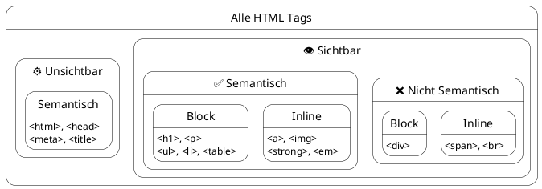

#### Welche Begriffe werden hier verwendet?
[``Client``](../../../05_Glossar.md#client), [``Server``](../../../05_Glossar.md#server), [``Statische Website``](../../../05_Glossar.md#statische-website), [``Dynamische Website``](../../../05_Glossar.md#dynamische-website), [``Single Page Application (SPA)``](../../../05_Glossar.md#spa), [``Web-API``](../../../05_Glossar.md#web-api), [``HTTP``](../../../05_Glossar.md#http), [``RESTful``](../../../05_Glossar.md#restful), [``HTML``](../../../05_Glossar.md#html), [``Tag``](../../../05_Glossar.md#tag), [``Start-Tag``](../../../05_Glossar.md#start-tag), [``Closing-Tag``](../../../05_Glossar.md#closing-tag), [``Non-Closing Tag``](../../../05_Glossar.md#non-closing-tag), [``Attribut``](../../../05_Glossar.md#attribut), [``HTML-Element``](../../../05_Glossar.md#html-element), [``Semantik``](../../../05_Glossar.md#semantik), [``Block-Element``](../../../05_Glossar.md#block-element), [``Inline-Element``](../../../05_Glossar.md#inline-element), [``Blindtext``](../../../05_Glossar.md#blindtext).

> **Zu diesem Skriptum gehört die Slide [L01.1-HTML-Ueberblick.html](L01.1-HTML-Ueberblick.html).** Öffne sie im Browser. Mit den Pfeiltasten ``←`` ``→`` gehst du Schritt für Schritt weiter, mit ``↑`` ``↓`` wechselst du den Tab. Oben rechts schaltest du zwischen **HTML** und **HTML + CSS** um (``1`` / ``2``) und kannst **Block / Inline** (``3``) und **Komponenten** (``4``) zuschalten – auch beide gleichzeitig.

# Client vs. Server

## 1. Wie das Web funktioniert: Client und Server

Bevor wir Code schreiben, müssen wir verstehen, wie Webseiten überhaupt auf unseren Bildschirm kommen. Das Internet basiert auf dem **Client-Server-Modell**.
*   Der **``Client``** ist der Bittsteller. In unserem Fall ist das der Webbrowser (Chrome, Firefox, Safari) auf deinem Laptop oder Smartphone.
*   Der **``Server``** ist ein leistungsstarker Computer im Internet, der Tag und Nacht läuft. Dort liegen die Dateien der Website.

Der Client sendet einen *Request* (eine Anfrage, z. B. die Eingabe einer URL) an den Server. Der Server verarbeitet diese Anfrage und schickt eine *Response* (eine Antwort, z. B. HTML-, CSS- und Bild-Dateien) zurück, die der Browser dann grafisch darstellt.

### Arten von Websites und wann man sie verwendet
Je nachdem, *wie* der Server diese Antwort zusammenstellt, unterscheiden wir verschiedene Architektur-Arten:

1.  **``Statische Websites``:** Die HTML-, CSS- und Bild-Dateien liegen exakt so auf dem Server, wie sie geschrieben wurden. Der Server nimmt die Datei und schickt sie unverändert an den Client.
    *   *Wann verwenden?* Für Portfolios, reine Informationsseiten, Dokumentationen oder Landingpages. Sie sind extrem schnell, sicher und günstig im Hosting.
2.  **``Dynamische Websites`` (Server-Side Rendered):** Die Webseite existiert nicht als fertige HTML-Datei. Stattdessen nutzt der Server eine Programmiersprache (wie PHP oder C#), um die HTML-Seite aus einer Datenbank neu zusammenzubauen, sobald ein User sie anfragt.
    *   *Wann verwenden?* Für Blogs, klassische Online-Shops oder Nachrichtenseiten – überall dort, wo sich Inhalte ständig ändern.
3.  **``Single Page Applications (SPA)`` & ``Web-APIs``:** Der Server schickt anfangs nur eine fast leere HTML-Datei. Ein JavaScript-Programm (z. B. Angular, React oder Vue) übernimmt im Browser die Kontrolle. Wenn neue Daten gebraucht werden, fragt das JavaScript im Hintergrund bei einer **``Web-API``** nach reinen Daten (JSON) und baut die Webseite direkt im Browser um.
    *   *Wann verwenden?* Für hochinteraktive Web-Apps wie Instagram, Netflix oder Google Maps, die sich wie eine App anfühlen sollen (ohne sichtbares Neuladen der Seite).

> **Wir merken uns:**
> 1. Der [``Client``](../../../05_Glossar.md#client) (Browser) fragt Daten an, der [``Server``](../../../05_Glossar.md#server) liefert sie aus.
> 2. Eine [``Statische Website``](../../../05_Glossar.md#statische-website) (unser Fokus) wird genau so ausgeliefert, wie sie als Datei am Server liegt. Eine [``Dynamische Website``](../../../05_Glossar.md#dynamische-website) wird bei jeder Anfrage vom Server neu zusammengebaut.
> 3. Eine [``SPA``](../../../05_Glossar.md#spa) lädt die Seite nicht neu. Die Logik liegt im Browser, der nur noch Rohdaten über eine [``Web-API``](../../../05_Glossar.md#web-api) anfordert.

---

## 2. Die Sprache des Internets: HTTP und RESTful

Damit der Client und der Server sich verstehen, müssen sie dieselbe "Sprache" sprechen. Diese Sprache heißt **``HTTP``** (Hypertext Transfer Protocol).

Ein HTTP-Request (die Anfrage des Clients) enthält immer eine Methode, die beschreibt, *was* der Client tun möchte:
*   **GET:** "Gib mir Daten!" (z. B. Lade die Seite `index.html` herunter).
*   **POST:** "Hier sind neue Daten, speichere sie!" (z. B. Ein Formular absenden – das bauen wir in [L01.4](L01.4-Formulare-Selection-Input.md)).

Der Server antwortet mit einem **HTTP-Statuscode**, der sagt, ob alles geklappt hat:
*   `200 OK`: Alles super, hier ist die Antwort.
*   `404 Not Found`: Die angefragte Seite existiert nicht.

### Was bedeutet RESTful?
Wenn wir eine **``Web-API``** programmieren, halten wir uns heute meist an das **``RESTful``**-Prinzip. Es besagt, dass wir die HTTP-Methoden logisch und vorhersehbar nutzen, um Daten (Ressourcen) zu verwalten.

Stell dir vor, unsere API verwaltet "Schüler":
*   `GET /schueler` → Liefert eine Liste aller Schüler.
*   `POST /schueler` → Legt einen neuen Schüler an.
*   `PUT /schueler/5` → Aktualisiert den Schüler mit der ID 5.
*   `DELETE /schueler/5` → Löscht den Schüler mit der ID 5.

> **Wir merken uns:**
> 4. [``HTTP``](../../../05_Glossar.md#http) ist das Protokoll (die Sprache), mit dem Client und Server kommunizieren. ``GET`` holt Daten, ``POST`` schickt Daten zum Speichern.
> 5. [``RESTful``](../../../05_Glossar.md#restful) ist eine Konvention für Web-APIs. Sie schreibt vor, die HTTP-Methoden (``GET``, ``POST``, ``PUT``, ``DELETE``) logisch für Datenbank-Aktionen zu nutzen.

---

# HTML

## 3. Die HTML-Syntax

HTML (**H**yper**t**ext **M**arkup **L**anguage) ist keine Programmiersprache mit Variablen oder Schleifen, sondern eine **Auszeichnungssprache**. Wir *annotieren* Text, damit der Browser weiß, wie er **strukturiert** ist. Wie der Text **aussieht**, legt später eine zweite Sprache fest: **CSS**.

HTML besteht aus **``Tags``**. Ein **``Element``** besteht aus einem ``Start-Tag``, dem Inhalt und einem ``Closing-Tag``:
*   **Start-Tag:** `<p>`
*   **Closing-Tag:** `</p>` (mit Schrägstrich)

Start-Tags können **``Attribute``** enthalten. Sie liefern dem Browser Zusatzinformationen. Ein Link `<a>` braucht z. B. das Attribut `href`, um das Ziel zu definieren:
```html
<a href="https://developer.mozilla.org/de/">MDN Web Docs</a>
```

### Analogie zur Programmierung: Tags sind Funktionen, Attribute sind Parameter

Aus C# kennen wir **Funktionen** (Methoden), denen wir beim Aufruf **Eingangsparameter** übergeben. Ein Tag funktioniert ganz ähnlich:

| Programmierung (C#) | HTML |
| :--- | :--- |
| Funktion / Methode, z. B. `Link(...)` | Tag, z. B. `<a>` |
| Eingangsparameter `ziel: "https://..."` | Attribut `href="https://..."` |
| Parametername und Wert | Attributname und Wert in Anführungszeichen |
| Pflicht- und optionale Parameter | Pflicht-Attribute (`src`, `alt` bei ``) und optionale (`width`) |

```csharp
// gedachte C#-Funktion
Link(ziel: "https://developer.mozilla.org/de/", text: "MDN Web Docs");
```

```html
<!-- dasselbe in HTML -->
<a href="https://developer.mozilla.org/de/">MDN Web Docs</a>
```

Der **Tag** sagt, *was* gemacht wird (ein Link), die **Attribute** liefern die Werte, *womit* es gemacht wird (das Ziel). Der Inhalt zwischen Start- und Closing-Tag ist der Text, auf den der Tag wirkt.

> **Wir merken uns:**
> 6. [``HTML``](../../../05_Glossar.md#html) ist keine Programmiersprache, sondern eine [``Auszeichnungssprache``](../../../05_Glossar.md#auszeichnungssprache), die dem Browser mitteilt, wie Text *strukturiert* ist. Wir trennen *Struktur* (``HTML``) und *Design* ([``CSS``](../../../05_Glossar.md#css)).
> 7. [``Tags``](../../../05_Glossar.md#tag) werden in spitzen Klammern ``<>`` geschrieben. Ein Element *beginnt* mit einem [``Start-Tag``](../../../05_Glossar.md#start-tag) wie ``<p>`` und *endet* mit einem [``Closing-Tag``](../../../05_Glossar.md#closing-tag) wie ``</p>``.
> 8. [``Attribute``](../../../05_Glossar.md#attribut) stehen immer im ``Start-Tag``, bestehen aus einem *Namen* und einem *Wert* in Anführungszeichen und liefern Zusatzinformationen, z. B. ``<a href="https://www.google.com/">``.
> 9. Ein ``Tag`` ist vergleichbar mit einer ``Funktion``/``Methode`` aus der Programmierung, seine ``Attribute`` mit den ``Eingangsparametern``: ``<a href="...">`` entspricht einem Aufruf wie ``Link(ziel: "...")``.
> 10. [``Elemente``](../../../05_Glossar.md#html-element) sind ``Tags`` und deren *Inhalt*.

---

## 4. Semantik – Bedeutung vor Aussehen

**``Semantisches HTML``** bedeutet, dass wir Tags verwenden, die beschreiben, *was* der Inhalt ist, und nicht, wie er aussehen soll.

Wenn ein Wort kursiv gedruckt werden soll, dachte man früher sofort an das `<i>`-Tag (für *italic*). Heute nutzen wir stattdessen **`<em>` (für *emphasis* / Betonung)**.
*   Das `<i>`-Tag ist **nicht semantisch**. Es sagt dem Browser nur: "Stell das schräg dar."
*   Das `<em>`-Tag ist **semantisch**. Es verleiht dem Wort inhaltliches Gewicht.

**Warum ist das wichtig?**
*   **Suchmaschinen (SEO):** Google wertet semantische Tags wie `<h1>` oder `<strong>` aus, um zu verstehen, worum es auf der Seite geht.
*   **Barrierefreiheit:** Screenreader (Vorleseprogramme für blinde Menschen) erkennen `<em>` und verändern die Betonung der Computerstimme.

> **Wir merken uns:**
> 11. [``Semantisches HTML``](../../../05_Glossar.md#semantik) bedeutet, dass ``Tags`` beschreiben, *was* der Inhalt ist, und nicht *wie* er aussehen soll. Das hilft Suchmaschinen (``SEO``) und Menschen, die auf Screenreader angewiesen sind.

---

## 5. Das Grundgerüst

Jede HTML-Datei braucht ein **Grundgerüst**. In der Slide siehst du es im Tab **„1 · Grundgerüst“** Zeile für Zeile entstehen.

```html
<!DOCTYPE html>
<html lang="de">
<head>
    <meta charset="UTF-8">
    <title>HTL Lernportal</title>
</head>
<body>
    <!-- Hier kommt der sichtbare Inhalt hinein -->
</body>
</html>
```

Das Prinzip kennen wir aus der Welt der *Character Encodings* (ASCII): Dort gibt es zuerst unsichtbare "Steuerzeichen" (wie *Line Feed* oder *Tab*), die das System steuern, und danach die "druckbaren Zeichen". Genau diese Trennung finden wir in HTML wieder:

1. **Das unsichtbare Grundgerüst (⚙️ wie die Steuerzeichen):** `<!DOCTYPE html>`, `<html>`, `<head>`, `<meta>`, `<title>`, `<body>`. Sie beschreiben die Datei selbst. Der `<title>` erscheint nur oben im Browser-Tab.
2. **Die sichtbaren Elemente (wie die druckbaren Zeichen):** Alles **innerhalb** des `<body>`. Diese zeichnet der Browser als **Block** oder **Inline** auf den Bildschirm.

>**Anmerkung:** In ``VS Code`` erzeugt ``!`` gefolgt von ``Tab`` dieses Grundgerüst automatisch.

> **Wir merken uns:**
> 12. Jedes HTML-Dokument benötigt ein *zwingendes Grundgerüst* aus ``<!DOCTYPE html>``, ``<html>``, ``<head>`` und ``<body>``. Wir nennen sie *unsichtbare* ``Tags``.
> 13. Alles, was im Browserfenster sichtbar sein soll, muss im [``<body>``](../../../05_Glossar.md#body) stehen. Der [``<head>``](../../../05_Glossar.md#head) enthält *Metadaten* wie ``<meta charset="UTF-8">`` und den ``<title>`` (Text im Browser-Tab).

---

## 6. Block- und Inline-Elemente

Alle sichtbaren HTML-Elemente teilen wir in zwei große Kategorien. In der Slide schaltest du sie oben rechts mit **„Block / Inline“** (Taste ``3``) zu: Blöcke sind **blau gestrichelt**, Inline-Elemente **gelb** und mit ihrem Tag-Namen beschriftet. Auch im Code sind Block-Tags blau und Inline-Tags gelb eingefärbt.

1. **``Block-Elemente`` (z. B. `<h1>`, `<p>`, `<ul>`, `<li>`, `<table>`):**
   Sie verhalten sich wie große Kisten. Ein Block-Element beansprucht immer die **volle verfügbare Breite** seines Eltern-Elements und erzeugt einen Zeilenumbruch davor und danach.
2. **``Inline-Elemente`` (z. B. `<a>`, `<strong>`, `<em>`, ``, `<br>`):**
   Sie verhalten sich wie einzelne Wörter. Sie nehmen nur **so viel Platz ein, wie ihr Inhalt benötigt**, fließen im Text mit und erzeugen *keinen* Zeilenumbruch.

> **Hinweis zu `<li>`:** Ein Listenpunkt wird als `list-item` dargestellt. Das ist ein Block, der zusätzlich einen Aufzählungspunkt (oder eine Nummer) davor bekommt. Für uns gilt `<li>` deshalb als Block.

### So schreiben wir Block und Inline im Code

Damit man die Struktur schon am Code erkennt, gilt bei uns eine feste Schreibweise:

```html
<p>
    Willkommen im <strong>Lernportal</strong> für <em>Web-Engineering</em>.
</p>
```

* **Block-Elemente:** Start-Tag und Closing-Tag stehen **untereinander** in eigenen Zeilen, der Inhalt ist eingerückt.
* **Inline-Elemente:** Start-Tag und Closing-Tag stehen **nebeneinander** in derselben Zeile – mitten im Text.

### Regeln beim Schachteln

Elemente ineinanderlegen nennt man **Schachteln** (*Nesting*) – wie bei russischen Matroschka-Puppen.

**Regel 1: Das Zwiebel-Prinzip (zuerst auf, zuletzt zu)**
Tags werden in der umgekehrten Reihenfolge geschlossen, in der sie geöffnet wurden. Sie dürfen sich niemals überkreuzen!
* 🟢 **Richtig:** `<p>Ein <strong>wichtiges</strong> Wort.</p>`
* 🔴 **Falsch:** `<p>Ein <strong>wichtiges</p></strong> Wort.`

**Regel 2: Block ist mit Block und Inline schachtelbar – es gibt Ausnahmen**
Ein Block darf andere Blöcke und Inline-Elemente enthalten. Ausnahmen, weil die *Bedeutung* des Blocks es verlangt:
* `<p>` und `<h1>`–`<h6>` sind Blöcke, dürfen aber **nur Inline-Elemente** enthalten. Ein `<ul>` in einem `<p>` ist verboten.
* `<ul>` und `<ol>` dürfen als direkte Kinder **ausschließlich** `<li>` enthalten.
* `<table>` enthält nur Zeilen `<tr>`, und erst diese enthalten Zellen `<th>` oder `<td>`.

**Regel 3: Inline ist nur mit Inline schachtelbar – es gibt keine Ausnahmen**
Ein Inline-Element darf nur andere Inline-Elemente enthalten, niemals einen Block.
* 🟢 **Richtig:** `<a href="kontakt.html"><strong>Kontakt</strong></a>`
* 🔴 **Falsch:** `<strong><h2>Überschrift</h2></strong>`

> **Für Interessierte:** Der HTML5-Standard erlaubt technisch, dass ein `<a>` ganze Blöcke umschließt (z. B. eine ganze Karte als Link). In unserer Welt machen wir das **nicht** – bei uns gilt Regel 3 ohne Ausnahme.

### Warum sieht meine Webseite trotzdem normal aus, wenn ich Fehler mache?

Wenn du in C# einen `Syntax`-Fehler machst, bricht der `Compiler` ab. HTML ist anders: Der Browser (unser `Renderer`) stürzt bei falscher Schachtelung nicht ab, sondern **repariert den Fehler heimlich** beim Einlesen (`Parsen`).

Im optionalen Slide-Tab **„⭐ Browser repariert“** siehst du das: Oben steht durchgestrichen, was wir falsch geschrieben haben, darunter, was der Browser daraus macht. Steht ein `<ul>` in einem `<p>`, beendet der Browser den Absatz vor der Liste und erzeugt zusätzlich einen leeren Absatz. Optisch fällt das kaum auf, trotzdem ist es ein `Bug`:
1. Suchmaschinen können die `Semantik` nicht mehr richtig lesen.
2. Screenreader lesen die Seite im schlimmsten Fall falsch vor.
3. Wenn du später mit `CSS` das Design änderst, verhält sich die Seite unberechenbar.

Einen **Linter** wie *HTMLHint* in VS Code zu verwenden, hilft, solche Fehler zu finden.

> **Wir merken uns:**
> 14. [``Block-Elemente``](../../../05_Glossar.md#block-element) verwenden die gesamte verfügbare Breite ihres Eltern-Elements und erzwingen davor und danach einen Zeilenumbruch, z. B. ``<h1>``, ``<p>``, ``<ul>``. Wir schreiben den ``Start-Tag`` und ``Closing-Tag`` *untereinander* in verschiedenen Zeilen.
> 15. [``Inline-Elemente``](../../../05_Glossar.md#inline-element) nehmen nur so viel Breite ein, wie ihr Inhalt benötigt, und fließen im Text mit, z. B. ``<a>``, ``<strong>``, ````. Wir schreiben den ``Start-Tag`` und ``Closing-Tag`` *nebeneinander* in derselben Zeile.
> 16. ``Block-Elemente`` sind mit ``Block-`` und ``Inline-Elementen`` schachtelbar – es gibt Ausnahmen: ``<p>`` und ``<h1>``–``<h6>`` enthalten nur ``Inline-Elemente``, ``<ul>``/``<ol>`` enthalten nur ``<li>``.
> 17. ``Inline-Elemente`` sind nur mit ``Inline-Elementen`` schachtelbar – es gibt keine Ausnahmen.
> 18. Tags werden wie eine Zwiebel geschlossen: Was zuletzt geöffnet wurde, wird zuerst geschlossen (kein Überkreuzen).
> 19. Der Browser (``Renderer``) stürzt bei falscher Schachtelung nicht ab, sondern repariert sie heimlich. Das sieht oft richtig aus, zerstört aber ``Semantik``, Barrierefreiheit und das spätere ``CSS``-Design.

---

## 7. Die wichtigsten Tags im Überblick

| HTML-Tag | Kategorie | Semantisch? | Non-Closing? | Bedeutung |
| :--- | :---: | :---: | :---: | :--- |
| **`<!DOCTYPE html>`** | `⚙️ unsichtbar` | ✅ Ja | 💠 **Ja** | **Deklaration (kein echter Tag).** Sagt dem Browser: "Das ist HTML5." |
| **`<html>`** | `⚙️ unsichtbar` | ✅ Ja | Nein | **Wurzelelement.** Umschließt das gesamte Dokument. |
| **`<head>`** | `⚙️ unsichtbar` | ✅ Ja | Nein | **Kopf der Datei.** Container für alle Metadaten. |
| **`<meta>`** | `⚙️ unsichtbar` | ✅ Ja | 💠 **Ja** | **Metadaten**, z. B. Zeichensatz UTF-8. |
| **`<title>`** | `⚙️ unsichtbar` | ✅ Ja | Nein | **Titel** im Tab-Reiter des Browsers. |
| **`<body>`** | `⚙️ unsichtbar` | ✅ Ja | Nein | **Körper.** Alles Sichtbare muss hier hinein. |
| `<h1>` bis `<h6>` | `Block` | ✅ Ja | Nein | **Headings.** Überschriften Ebene 1 (wichtigste) bis 6. |
| `<p>` | `Block` | ✅ Ja | Nein | **Paragraph.** Ein Textabsatz. |
| `<ul>` / `<ol>` | `Block` | ✅ Ja | Nein | **Unordered / Ordered List.** Aufzählung / nummerierte Liste. |
| `<li>` | `Block` | ✅ Ja | Nein | **List Item.** Listenpunkt (nur in `<ul>` oder `<ol>`). |
| `<table>` | `Block` | ✅ Ja | Nein | **Tabelle** für zweidimensionale Daten. |
| `<tr>` / `<th>` / `<td>` | `Tabelle` | ✅ Ja | Nein | **Zeile / Überschrift-Zelle / Daten-Zelle.** |
| `<hr>` | `Block` | ✅ Ja | 💠 **Ja** | **Horizontal Rule.** Thematischer Umbruch (als Linie dargestellt). |
| **`<div>`** | `Block` | ❌ **Nein** | Nein | **Division.** Beispiel für einen Tag *ohne* Bedeutung. |
| `<a>` | `Inline` | ✅ Ja | Nein | **Anchor.** Hyperlink, braucht `href`. |
| `<strong>` | `Inline` | ✅ Ja | Nein | **Starke Wichtigkeit** (standardmäßig fett). |
| `<em>` | `Inline` | ✅ Ja | Nein | **Emphasis.** Betonung im Satz (standardmäßig kursiv). |
| `` | `Inline` | ✅ Ja | 💠 **Ja** | **Image.** Bild, braucht `src` und `alt`. |
| `<br>` | `Inline` | ❌ **Nein** | 💠 **Ja** | **Line Break.** Zeilenumbruch innerhalb eines Absatzes. |
| **`<span>`** | `Inline` | ❌ **Nein** | Nein | Beispiel für einen Inline-Tag *ohne* Bedeutung. |
| **`<b>` / `<i>`** | `Inline` | ❌ **Nein** | Nein | **Veraltet!** Rein optisch fett/kursiv – wir nehmen `<strong>` / `<em>`. |

Die Seitenzonen `<header>`, `<nav>`, `<main>`, `<aside>`, `<footer>` lernen wir in [L01.2](L01.2-Header-Main-Footer-Nav-Aside.md), `<section>` und `<article>` in [L01.3](L01.3-Section-Article.md) und Formular-Tags in [L01.4](L01.4-Formulare-Selection-Input.md).



---

## 8. Praxis: Die erste Seite unseres Lernportals

Ab jetzt bauen wir in allen Slides an **einem durchgehenden Beispiel**: dem **HTL Lernportal**. In L01.1 schreiben wir den Inhalt, in L01.2 ordnen wir ihn in Zonen, in L01.3 gliedern wir ihn in Kapitel und Beiträge und in L01.4 kommen Formulare dazu.

Die Slide zeigt jeden Schritt einzeln, neue Zeilen sind **grün** markiert. **Rot durchgestrichen** wird nur, was konzeptionell **falsch** ist – wie im optionalen Tab „⭐ Browser repariert“, wo darunter (blau, mit ⇒) steht, was der Browser daraus macht:

| Slide-Tab | Was kommt dazu? |
| :--- | :--- |
| 1 · Grundgerüst | `<!DOCTYPE html>`, `<html>`, `<head>`, `<meta>`, `<title>`, `<body>` |
| 2 · Text & Betonung | `<h1>`, `<p>`, `<strong>`, `<em>`, `<h2>`, Blindtext |
| 3 · Listen & Links | `<ul>`, `<li>`, `<a href>`, `<ol>` |
| 4 · Bild & Tabelle | ``, `<hr>`, `<table>`, `<tr>`, `<th>`, `<td>`, `<br>` |
| ⭐ Browser repariert | *optional:* was der Browser aus falscher Schachtelung macht |

Solange der echte Text fehlt, nutzen wir **``Blindtext``** (*Lorem Ipsum*). Dieser Pseudo-Latein-Text hat eine natürliche Wortverteilung und lenkt beim Aufbau nicht ab.

Am Ende von Tab 4 sieht der `<body>` so aus (gekürzt):

```html
<body>
    <h1>
        HTL Lernportal
    </h1>
    <p>
        
        Willkommen im <strong>Lernportal</strong> für <em>Web-Engineering</em>.
    </p>
    <h2>
        Unsere Kapitel
    </h2>
    <ul>
        <li>
            <a href="grundlagen.html">Grundlagen</a>
        </li>
        <li>
            <a href="layout.html">Layout mit Zonen</a>
        </li>
    </ul>
    <hr>
    <h2>
        Stundenplan
    </h2>
    <table>
        <tr>
            <th>
                Tag
            </th>
            <th>
                Thema
            </th>
        </tr>
        <tr>
            <td>
                Montag
            </td>
            <td>
                HTML-Grundgerüst
            </td>
        </tr>
    </table>
    <h2>
        Kontakt
    </h2>
    <p>
        HTL Musterstadt<br>
        Musterstraße 42<br>
        1010 Wien
    </p>
</body>
```

**Warum ist das noch keine fertige Webseite?** Alles steht einfach untereinander. Der Browser weiß nicht, was Kopf, Navigation oder Hauptinhalt ist. Genau das lösen wir in [L01.2](L01.2-Header-Main-Footer-Nav-Aside.md) mit den **Seitenzonen**.

> **Wir merken uns:**
> 20. ``<h1>`` bis ``<h6>`` beschreiben die *Gliederung* der Seite, nicht die Schriftgröße. Pro Seite gibt es genau eine ``<h1>``.
> 21. Der [``<p>``](../../../05_Glossar.md#paragraph)-Tag umschließt Textabsätze. Fließtext steht niemals „nackt“ in einem Container, sondern immer in einem ``<p>``.
> 22. [``<strong>``](../../../05_Glossar.md#strong) markiert inhaltliche Wichtigkeit (fett), [``<em>``](../../../05_Glossar.md#emphasis) eine sprachliche Betonung im Satz (kursiv).
> 23. ``<ul>`` ist eine ungeordnete, ``<ol>`` eine nummerierte Liste. Beide enthalten nur ``<li>``-Elemente. ``<ol>`` verwenden wir, wenn die Reihenfolge eine Bedeutung hat.
> 24. Der [``<a>``](../../../05_Glossar.md#anchor)-Tag erzeugt Links über ``href``: zu **anderen Webseiten** mit absoluter URL (``https://...``), zu **Dateien derselben Website** mit relativem Pfad (``grundlagen.html``) oder zu **System-Aktionen** (``mailto:...``).
> 25. [``Non-Closing Tags``](../../../05_Glossar.md#non-closing-tag) umschließen keinen Inhalt und haben kein ``Closing-Tag``, z. B. ``<meta>``, ````, ``<br>``, ``<hr>``, ``<input>``.
> 26. ```` ist ein leeres Inline-Element. ``src`` gibt den Bildpfad an, das Pflicht-Attribut ``alt`` beschreibt das Bild für Screenreader und Ladefehler.
> 27. [``<table>``](../../../05_Glossar.md#table) enthält Zeilen ``<tr>`` mit Überschrift-Zellen ``<th>`` und Daten-Zellen ``<td>``. Tabellen verwenden wir nur für echte Tabellen-Daten – **niemals für das Seiten-Layout**.
> 28. ``<br>`` bricht eine Zeile **innerhalb** eines Absatzes um (z. B. bei einer Adresse), nie für Abstände. [``<hr>``](../../../05_Glossar.md#horizontal-rule) markiert einen thematischen Umbruch.
