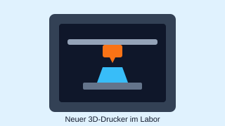

#### Welche Begriffe werden hier verwendet?
[``HTTP``](../../../05_Glossar.md#http), [``Client``](../../../05_Glossar.md#client), [``Server``](../../../05_Glossar.md#server), [``Attribut``](../../../05_Glossar.md#attribut), [``Non-Closing Tag``](../../../05_Glossar.md#non-closing-tag), [``Inline-Element``](../../../05_Glossar.md#inline-element), [``<a>``](../../../05_Glossar.md#anchor).

> **Zu diesem Skriptum gehört die Slide [L01.4-Formulare-Selection-Input.html](L01.4-Formulare-Selection-Input.html).** ``←`` ``→`` wechselt die Schritte, ``↑`` ``↓`` die Tabs. Oben rechts: ``1`` HTML, ``2`` HTML + CSS, ``3`` Block / Inline zuschalten, ``4`` Komponenten zuschalten.

# Medien, Buttons und Formulare

Wir arbeiten weiter an der Neuigkeiten-Seite unseres Lernportals aus [L01.3](L01.3-Section-Article.md):

| Slide-Tab | Was lernen wir? |
| :--- | :--- |
| 1 · Bild & Aufklappen | `<figure>`, ``, `<figcaption>`, `<details>`, `<summary>` |
| 2 · a oder button? | Navigation vs. Aktion |
| 3 · Formular mit GET | `<form>`, `action`, `method="GET"`, `<label>`, `<input>`, `name` |
| 4 · Formular mit POST | `method="POST"`, Input-Typen, `<select>`, Radio-Buttons, `<textarea>`, Checkbox |

---

## 1. Bilder als eigene Einheit: `<figure>`

`` kennen wir aus [L01.1](L01.1-HTML-Ueberblick.md): ein leeres Inline-Element mit `src` und `alt`. Steht ein Bild **für sich** – wie ein Foto mit Bildunterschrift in einer Zeitung – packen wir es in ein `<figure>`. Die Bildunterschrift `<figcaption>` steht **im** `<figure>` und ist dadurch fest mit dem Bild verbunden.

```html
<figure>
    
    <figcaption>
        Abb. 1: Der neue 3D-Drucker im Labor
    </figcaption>
</figure>
```

**Was gehört in `alt`?** Eine kurze Beschreibung dessen, was man sieht – so, dass jemand, der das Bild nicht sehen kann, nichts Wichtiges verpasst.

## 2. Aufklappen ohne JavaScript: `<details>`

`<details>` ist ein Bereich, der **auf- und zugeklappt** werden kann. `<summary>` ist die immer sichtbare Zeile zum Anklicken, alles danach ist der versteckte Inhalt. Das funktioniert **ohne JavaScript**.

```html
<details>
    <summary>
        Technische Daten anzeigen
    </summary>
    <ul>
        <li>
            Bauraum: 250 &times; 210 &times; 220 mm
        </li>
    </ul>
</details>
```

---

## 3. `<a>` oder `<button>`?

Beide sehen mit CSS später gleich aus – wie ein Knopf. Wir entscheiden **nie nach dem Aussehen**, sondern nach der **Funktion**:

| | `<a href="...">` | `<button type="button">` |
| :--- | :--- | :--- |
| **Was passiert?** | Wir **gehen woanders hin** | Wir **tun etwas** auf dieser Seite |
| **Adresszeile** | ändert sich | bleibt gleich |
| **Beispiele** | andere Seite, `#anker`, externe Website | Beitrag merken, dunkles Design, Formular absenden |

```html
<p>
    Veröffentlicht am <time datetime="2026-10-15">15. Oktober 2026</time> &bull; <a href="news/3d-drucker.html">Ganzen Beitrag lesen</a>
</p>
<p>
    <button type="button">Beitrag merken</button>
</p>
```

Was ein `<button type="button">` genau tut, programmiert man später mit JavaScript. Jetzt beschreiben wir nur, **dass** es eine Aktion ist.

---

## 4. Formulare: Daten an den Server schicken

Bisher schickt der Server Inhalte **zum** Browser. Mit einem Formular schickt der **Browser Daten an einen Server** – ganz ohne JavaScript. Das ist die Client-Server-Kommunikation aus [L01.1](L01.1-HTML-Ueberblick.md), Abschnitt 2.

```html
<form action="https://www.google.com/search" method="GET">
    ...
</form>
```

* **`action`** – die **Adresse des Servers**, an den die Daten gehen.
* **`method`** – **wie** die Daten übertragen werden: `GET` oder `POST`.

### `<label>` und `<input>`: id ist nicht name!

```html
<p>
    <label for="suchbegriff">Suchbegriff:</label>
    <input id="suchbegriff" type="search" name="q">
</p>
```

* `<input>` ist ein **Non-Closing Tag** und inline.
* `<label for="suchbegriff">` beschriftet das Feld mit `id="suchbegriff"`. Ein Klick auf die Beschriftung setzt den Cursor ins Feld, und Screenreader lesen die Beschriftung vor.
* `name="q"` ist der **Schlüssel für den Server**. Beim Absenden schickt der Browser `q=<eingegebener Text>`. **Ohne `name` wird der Wert nicht mitgeschickt!**
* Ein `<button type="submit">` schickt das Formular ab.

Label und Feld packen wir jeweils in einen Absatz `<p>`, damit jedes Paar in einer eigenen Zeile steht.

### GET oder POST?

In der Slide kannst du beide Formulare ausfüllen und absenden. Unten erscheint dann der HTTP-Request, den der Browser schicken würde:

```text
GET https://www.google.com/search?q=HTL+3D-Drucker
```

```text
POST https://httpbin.org/post
Content-Type: application/x-www-form-urlencoded

titel=Wetterstation&email=max%40htl.at&abteilung=if&gruppe=2
```

| | `method="GET"` | `method="POST"` |
| :--- | :--- | :--- |
| **Wo stehen die Daten?** | sichtbar **in der URL** nach dem `?` (`?q=htl&seite=2`) | unsichtbar im **Body** des Requests |
| **Wofür?** | Suchen, Filtern, Abfragen – man kann die URL als Lesezeichen speichern | Anmelden, Registrieren, Speichern, Passwörter |
| **Beispiel in der Slide** | Suche (Tab 3) | Diplomprojekt-Anmeldung (Tab 4) |

> **Warum `httpbin.org`?** Wir haben noch keinen eigenen Server programmiert. `https://httpbin.org/post` ist ein Test-Server, der einfach zurückschickt, was bei ihm angekommen ist. So sehen wir, dass unser Formular funktioniert.

---

## 5. Eingabefelder und Auswahlmöglichkeiten

Aus einem einzigen `<input>` werden über das Attribut `type` ganz verschiedene Felder:

| `type` | Was ist das? | Besonderheit |
| :--- | :--- | :--- |
| `text` | einzeiliges Textfeld | Standard |
| `search` | Suchfeld | wie `text`, mit Löschen-Kreuz |
| `email` | E-Mail-Adresse | Browser prüft auf `@` |
| `password` | Passwort | Eingabe wird versteckt |
| `number` | Zahl | nur Ziffern |
| `date` | Datum | Browser zeigt einen Kalender |
| `radio` | genau **eine** Möglichkeit aus einer Gruppe | gleicher `name` für die ganze Gruppe |
| `checkbox` | Häkchen an/aus | einzeln an- oder abwählbar |

Weitere Attribute:
* **`required`** – steht allein ohne Wert. Das Formular wird erst abgeschickt, wenn das Feld ausgefüllt ist.
* **`checked`** – wählt einen Radio-Button oder eine Checkbox vor.
* **`placeholder`** – grauer Hinweistext im leeren Feld (ersetzt **kein** `<label>`).

### Auswahlmenü: `<select>` und `<option>`

```html
<p>
    <label for="abteilung">Abteilung:</label>
    <select id="abteilung" name="abteilung">
        <option value="if">Informatik</option>
        <option value="et">Elektrotechnik</option>
    </select>
</p>
```

Der Text zwischen den `<option>`-Tags ist für Menschen. An den Server geht `name=value`, also `abteilung=if`.

### Radio-Buttons: `<fieldset>` und `<legend>`

```html
<fieldset>
    <legend>
        Gruppengröße
    </legend>
    <p>
        <input id="g2" type="radio" name="gruppe" value="2" checked>
        <label for="g2">2 Personen</label>
    </p>
    <p>
        <input id="g3" type="radio" name="gruppe" value="3">
        <label for="g3">3 Personen</label>
    </p>
</fieldset>
```

Alle Radio-Buttons einer Gruppe haben **denselben** `name` – nur so weiß der Browser, dass man genau einen davon wählen darf. `<fieldset>` fasst die Gruppe zusammen, `<legend>` ist ihre Überschrift.

### Mehrzeiliger Text: `<textarea>`

```html
<p>
    <label for="idee">Projektidee:</label>
    <textarea id="idee" name="idee" rows="4"></textarea>
</p>
```

Anders als `<input>` hat `<textarea>` ein **Closing-Tag**. Text zwischen den Tags wäre der Startwert.

> **Ausblick:** Mit **„HTML + CSS“** siehst du in der Slide dasselbe Formular mit CSS, mit **„Komponenten“** die Bausteine `SearchForm` und `RegistrationForm`. Beides wird später behandelt.

> **Wir merken uns:**
> 1. ``<figure>`` umschließt ein Bild (oder Diagramm) als eigenständige Block-Einheit. ``<figcaption>`` ist die Bildunterschrift und steht im ``<figure>``. Das Pflicht-Attribut ``alt`` von ```` beschreibt, was man sieht.
> 2. ``<details>`` und ``<summary>`` bilden einen auf- und zuklappbaren Bereich ohne JavaScript. ``<summary>`` ist die immer sichtbare Zeile.
> 3. Wir entscheiden nach der **Funktion**, nicht nach dem Aussehen: [``<a href>``](../../../05_Glossar.md#anchor), wenn wir zu einer anderen Seite, URL oder einem ``#anker`` **navigieren**, ``<button>``, wenn wir auf der aktuellen Seite eine **Aktion** auslösen.
> 4. ``<form>`` bündelt Eingaben und schickt sie ohne JavaScript als [``HTTP``](../../../05_Glossar.md#http)-Request vom ``Client`` an den ``Server``. ``action`` ist die Adresse des Servers, ``method`` die Übertragungsart.
> 5. ``method="GET"`` hängt die Daten sichtbar an die URL (``?q=htl&seite=2``) – für Suchen und Abfragen. ``method="POST"`` schickt die Daten unsichtbar im Body – für Anmeldungen, Passwörter und alles, was gespeichert wird.
> 6. ``<label for="feld-id">`` beschriftet das Eingabefeld mit derselben ``id``. Das ``name``-Attribut ist der Schlüssel für den Server – ohne ``name`` wird ein Wert nicht mitgeschickt.
> 7. ``<input>`` ist ein ``Non-Closing Tag``. Das Attribut ``type`` bestimmt das Feld: ``text``, ``email``, ``password``, ``number``, ``date``, ``radio``, ``checkbox`` … ``required`` erzwingt eine Eingabe.
> 8. ``<select>`` mit ``<option value="...">`` erzeugt ein Auswahlmenü. An den Server geht der ``value``, nicht der angezeigte Text.
> 9. Radio-Buttons einer Gruppe haben denselben ``name``, man wählt genau einen. ``<fieldset>`` gruppiert zusammengehörige Felder, ``<legend>`` ist die Überschrift der Gruppe.
> 10. ``<textarea>`` ist ein mehrzeiliges Textfeld und hat im Gegensatz zu ``<input>`` ein ``Closing-Tag``. ``<button type="submit">`` schickt das Formular ab.
